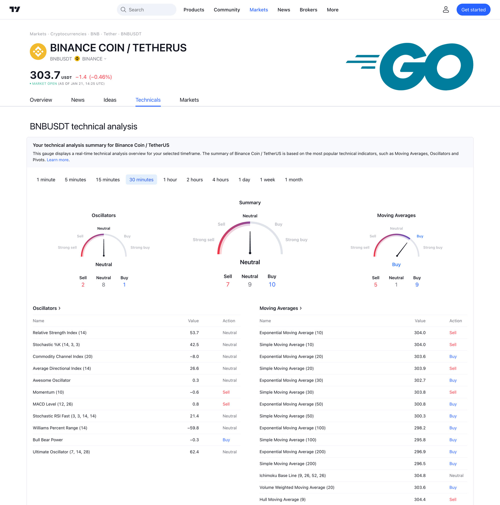

<p align="center">
  
</p>

<h1 align="center">go-tradingview-ta</h1>

<p align="center">
  A focused Go client for TradingView scanner data.
  Fetch normalized recommendation signals and raw indicator values with a small,
  idiomatic API.
</p>

<p align="center">
  <a href="https://pkg.go.dev/github.com/artlevitan/go-tradingview-ta"></a>
  
  
  
</p>

`go-tradingview-ta` is an unofficial Go client for TradingView's public scanner
endpoint. It retrieves both normalized recommendation signals and the raw
indicator values returned by TradingView.

The zero values of `TradingView` and `Client` are ready to use.
Go 1.27 or later is required.

## Why This Package

- Small API surface with an idiomatic Go layout.
- Raw numeric values and normalized `Strong Sell` to `Strong Buy` signals.
- Support for daily and intraday intervals.
- Configurable HTTP client for tests, custom transports, and alternative endpoints.

## Installation

```bash
go get github.com/artlevitan/go-tradingview-ta@latest
```

## Quick Start

```go
package main

import (
	"context"
	"fmt"
	"log"
	"time"

	tradingview "github.com/artlevitan/go-tradingview-ta"
)

func main() {
	ctx, cancel := context.WithTimeout(context.Background(), 5*time.Second)
	defer cancel()
	var ta tradingview.TradingView

	if err := ta.GetContext(ctx, "BINANCE:BTCUSDT", tradingview.Interval4Hour); err != nil {
		log.Fatal(err)
	}

	fmt.Println("summary:", ta.Recommend.Global.Summary)
	fmt.Println("close:", ta.Value.Prices.Close)
}
```

Use `(*TradingView).GetContext` to validate intervals and control request
cancellation and deadlines. `Get` remains available as a compatibility wrapper.
Use `Client` directly with a custom `HTTPClient` or `BaseURL` when needed.

`TradingView.Recommend` contains normalized recommendation signals:

```go
tradingview.SignalStrongSell
tradingview.SignalSell
tradingview.SignalNeutral
tradingview.SignalBuy
tradingview.SignalStrongBuy
tradingview.SignalUnavailable
```

`TradingView.Value` contains numeric values for the requested symbol and interval.
The existing `float64` fields use zero when a value is unavailable. Use
`HasValue` or `Raw` to distinguish an unavailable value from a real zero:

```go
if ta.HasValue("EMA200") {
	fmt.Println("EMA200:", ta.Value.MovingAverages.EMA200)
} else {
	fmt.Println("EMA200: unavailable")
}
```

`TradingView.Raw` preserves all 83 requested numeric scanner fields, including
JSON `null`. `Raw.Lookup("EMA200")` returns `(value, available)`. `Raw.Map()`
returns an independent `map[string]*float64` copy, including nulls. Its keys do
not include interval suffixes: use `"EMA200"`, `"RSI[1]"`, or
`"Pivot.M.Classic.S3"` for any timeframe. JSON serialization preserves the raw
object and its null fields.
Recommendations with unavailable inputs return `SignalUnavailable` (`3`).
This is a separate state, outside the recommendation scale `[-2, 2]`;
handle it explicitly before comparing or aggregating signals.

For example, monthly BTCUSDT may not have enough history for EMA200 or SMA200.
Their values remain `null` in `Raw` and their recommendations are unavailable.

For custom transports, tests, or alternative endpoints, use `tradingview.Client`
directly.

```go
client := tradingview.Client{
	HTTPClient: http.DefaultClient,
}
ctx, cancel := context.WithTimeout(context.Background(), 5*time.Second)
defer cancel()

var ta tradingview.TradingView
if err := client.GetContext(ctx, &ta, "BINANCE:BTCUSDT", tradingview.Interval1Hour); err != nil {
	log.Fatal(err)
}
```

## Features

- TradingView-style recommendation buckets for summary, oscillators, and moving averages.
- Raw values for RSI, Stoch, CCI20, ADX, AO, Momentum, MACD, pivots, moving averages, and price fields.
- Public `Client` type for dependency injection and deterministic tests.
- Explicit availability and snapshot metadata, including the scanner's update mode.
- Lightweight package design that stays close to standard Go conventions.

## Intervals

```go
tradingview.Interval1Min
tradingview.Interval5Min
tradingview.Interval15Min
tradingview.Interval30Min
tradingview.Interval1Hour
tradingview.Interval2Hour
tradingview.Interval4Hour
tradingview.Interval1Day
tradingview.Interval1Week
tradingview.Interval1Month
```

An empty interval requests daily data. `GetContext` rejects any unsupported
nonempty string with `ErrInvalidInterval`; use `Interval4Hour` (`"240"`) instead
of `"4h"`. For compatibility with v1.3, `Get` still treats unsupported intervals
as daily data.

## Snapshot metadata

`TradingView.Metadata` contains `Symbol`, `Interval`, `FetchedAt`, `BarTime`, and
`UpdateMode`. `BarTime` is the opening time of the requested candle, not the time
of the last trade. `FetchedAt` records when this client decoded the response;
it does not guarantee that the market data is current. Times are in UTC.

`UpdateMode` preserves the scanner's value, such as `"streaming"` or
`"delayed_streaming_900"` (15-minute delayed data). A missing mode is an empty
string, and a missing candle time is a zero `time.Time`; neither implies fresh
data. Each `Get` fetches one snapshot. There is no background polling, and values
for an open candle can change between requests.

## Validation and compatibility

`Get` rejects missing requested indicator keys, malformed values, a null close,
and out-of-range ratings with `ErrInvalidResponse`. Explicit `null` indicator
values are valid and are preserved. On any error, the previous snapshot remains
unchanged; callers must check the returned error before using it. Duplicate
JSON keys, invalid UTF-8, and responses larger than 1 MiB are rejected.

The existing `Recommend` and `Value` field types are unchanged. Consumers should
handle `SignalUnavailable`, check `HasValue` before using nullable numeric fields,
and account for the new `Raw` and `Metadata` fields when serializing the snapshot.
`TradingView` remains comparable, so existing comparisons and map-key usage
continue to compile. New snapshot metadata participates in comparisons;
compare `Value` or `Recommend` explicitly when comparing analysis results.

`Client` can be reused concurrently with separate `TradingView` destinations.
Do not mutate client configuration or `DefaultClient` during requests, or read
or update the same destination concurrently without synchronization. A custom
HTTP client is used with its own timeout; use context deadlines when supplying
an HTTP client without a timeout. No automatic retries are performed.

Non-200 responses return `*HTTPError`, which exposes `StatusCode`, a bounded
`Body` excerpt, and the unparsed `RetryAfter` header. Use `errors.As` to inspect
it and `errors.Is` to check validation errors or context cancellation:

```go
var statusErr *tradingview.HTTPError
switch {
case errors.Is(err, context.Canceled):
	// The caller canceled the request.
case errors.Is(err, tradingview.ErrInvalidInterval):
	// Select a supported interval.
case errors.As(err, &statusErr):
	fmt.Println(statusErr.StatusCode, statusErr.RetryAfter)
}
```

See [CHANGELOG.md](CHANGELOG.md) for the v1.4.0 release notes.

Aggregate scores come directly from TradingView. Individual Stochastic and ADX
signals retain the existing crossover rules. TradingView's
[published conditions](https://www.tradingview.com/support/solutions/43000475547-what-do-the-ratings-in-the-screener-mean/)
and observed technicals-page behavior differ, so exact agreement with every
TradingView indicator or screen is not guaranteed. The monthly snapshot test
records the values and counts observed on the official technicals page.

## Tests

Unit tests run without external network requests:

```bash
go test ./...
go vet ./...
go fix -diff ./...
go test -race -shuffle=on -coverprofile=coverage.out ./...
go test -run '^$' -fuzz '^FuzzGetContext$' -fuzztime=10s -parallel=2 ./...
```

Live checks for all ten supported BTCUSDT intervals, ETHUSDT, AAPL, and EURUSD
require public network access and are opt-in:

```bash
go test -tags=integration -run TestLive -count=1 -v ./...
```

CI runs formatting, module, vet, modernization, and race checks on Linux,
macOS, and Windows using Go 1.27. Linux also runs a short fuzzing check. Live
TradingView checks are available through the manual workflow's `live` input.

## License

[MIT](LICENSE)
